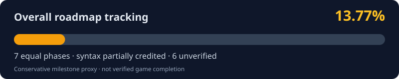
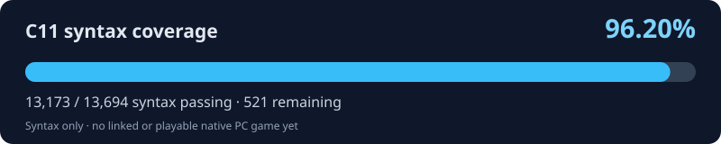

# BruteForce: Reloaded

**An unofficial, evidence-driven reconstruction of Brute Force (2003) for native Windows PC.** BruteForceDecomp remains the original Xbox C11 reconstruction workspace; BruteForce: Reloaded is the planned native PC release with an optional enhanced mode. Neither the playable PC game nor enhancement features exist yet.

<!-- BF_PROGRESS_START -->
## Reconstruction progress

**Overall tracked roadmap: 14.03%** (conservative milestone indicator, **not verified game completion**). Seven equally weighted phases: the audited C11 syntax pass fraction contributes to one phase, while the other six are unverified and receive zero completion credit until evidence-based metrics exist. This is a planning proxy, not a verified 1:1 or playable-game percentage.

**98.22% C11 syntax coverage** · **13,450 / 13,694** individually checked functions · **244** still fail. [Exact audited commit](https://github.com/firebirdjsb/BruteForceDecomp/commit/cfe06c35c68d86ee2dc512a210375ad020f3f5b5) · [GitHub Actions report](https://github.com/firebirdjsb/BruteForceDecomp/actions/runs/40355193459).

**Native PC game: NOT buildable/playable yet.** A syntax pass is not Xbox ABI verification, cross-function linking, platform compatibility, or a 1:1 match. This percentage is **not** game-completion percentage.

**Fully verified instruction contracts / interfaces:** not yet comprehensively counted. Partial operand and storage evidence is recorded per entry; it is not credited as whole-function verification.

| Roadmap phase | Credited progress |
| --- | --- |
| 1. Isolated host C11 syntax | 98.22% source drafts passing |
| 2. Original Xbox ABI, types and structures | Unverified |
| 3. Cross-function linking | Unverified |
| 4. Original 1:1 behavioral testing | Unverified |
| 5. Xbox-to-Windows platform services | Unverified |
| 6. Playable native Windows baseline | Unverified |
| 7. Optional Reloaded enhancements | Unverified |

[Machine-readable progress](docs/progress/current.json) · [Detailed status](docs/STATUS.md) · [Native PC milestones](docs/NATIVE_PC_PORT_GOALS.md)

<!-- BF_PROGRESS_END -->

Public, evidence-driven research workspace for the original Xbox 32-bit x86 `default.xbe`. This is a **source reconstruction**, not original source code or a proven byte-identical reimplementation.

## Baseline

- Game: Brute Force (original Xbox), provided XBE SHA-256: `B6EA5D4DD6500AE86C3F5E3E4618BC9B1E3FACDDCB483170DFEE7A787087C721`
- Ghidra identified **13,694** functions; all 13,694 were exported to the user's local `FunctionExport` directory. These counts are Ghidra discoveries, **not** proof of complete code recovery.
- Input migration archive contains **103 unverified legacy C++ drafts**. These must be reviewed and migrated to **C11**, not mechanically relabeled as `.c`.

## Rules

1. All *new and active* reconstructed source lives in `src/` and uses **C11** (`.c`, `.h`), not C++.
2. Preserve provenance: x86 entry address, original function-body SHA-256, evidence limitations, and TODOs for unknown ABI/external calls.
3. Keep uncertain code marked `DRAFT`, `ABI_UNVERIFIED`, or `REVIEW_REQUIRED`; compilability does not imply correctness or byte equivalence.
4. Never commit the original executable, game assets, ISOs, Ghidra project databases, full decompiler dumps, private local paths, or authentication credentials. Git stores small metadata, scripts and carefully scoped reconstructions only.
5. Review every generated change. Keep a function-by-function audit trail and test C syntax before marking any draft buildable.

## One faithful game core, two planned modes

**BruteForceDecomp** is the original Xbox 1:1 C11 reconstruction and provenance research. **BruteForce: Reloaded** is the name of the planned **native Windows PC game** built from that core, not an Xbox emulator.

- **Original Mode (planned):** recreate the original Xbox gameplay, physics, timing, level flow, and original multiplayer rules as faithfully as verified evidence permits, using native PC replacements for Xbox hardware and platform services.
- **Reloaded Mode (planned):** offer optional widescreen and ultrawide resolutions, high-refresh-rate-safe simulation and rendering, HD texture support, modern input, expanded multiplayer with a **64-player goal**, and modding support.

Both modes would use the same reconstructed original game core. Keep verified 1:1 functions and original x86 identities unchanged; isolate Windows backends, compatibility fixes and optional enhancements behind independently tested interfaces. Do not claim exact 1:1 behavior from syntax checks, and do not rewrite verified game code for an enhancement. The existing [source layout](src/README.md) is evidence-based; separate platform/enhancement modules are a future architectural goal, not folders claimed to exist today.

**Neither mode is currently buildable or playable.** Expanded multiplayer requires network architecture work and load testing, not just increasing a player-limit constant. See [native PC port goals and verification gates](docs/NATIVE_PC_PORT_GOALS.md).

**External reference, not a substitute for evidence:** [XboxRecomp and our 1:1 fidelity policy](docs/XBOXRECOMP_REFERENCE_1TO1.md) explains how its ABI, guest-register, and platform techniques can inform this project. Brute Force's own XBE remains the sole authority for original-game function semantics; the source and original-mode behavior cannot be replaced by guessed output from another recompiler.

## Collaborate

This public repository accepts [issues](https://github.com/firebirdjsb/BruteForceDecomp/issues) and [pull requests](https://github.com/firebirdjsb/BruteForceDecomp/pulls). See [CONTRIBUTING.md](CONTRIBUTING.md) for function-by-function evidence requirements and [SECURITY.md](SECURITY.md) for sensitive reporting. `main` is the only long-lived branch; short-lived feature branches and forks are allowed. **Public visibility does not by itself grant an open-source license.**

## Getting started

Clone `https://github.com/firebirdjsb/BruteForceDecomp.git` to Windows. Keep the existing `D:\Downloads\BruteForce-Decompilation` directory as the *local evidence store*, outside this Git checkout. See `AGENTS.md` and `docs/STATUS.md` for workflow, and the companion C-only local viewer/runner package for continued work.

**Never upload copyrighted Xbox game binaries, ISO files, assets, full Ghidra dumps, or credentials to this public repository.**
## Browsing recovered functions

The C11 source tree is now organized by **observed XBE sections**, unclassified main-executable address bands, and the small list of [assembly-supported readable names](metadata/asm_supported_readable_names.csv). Start at [src/README.md](src/README.md). All **13,694** files keep their original x86 address filename and original function-body digest. `tools/source_layout.py` is the canonical path resolver used by C11 audits and provenance checks. Directory organization is **not** a native PC build or proof of 1:1 behavior.
