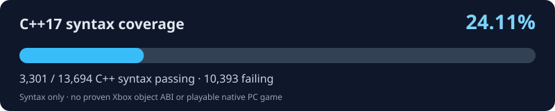

# BruteForce: Reloaded

**An unofficial, evidence-driven reconstruction of Brute Force (2003) for native Windows PC.** BruteForceDecomp reconstructs the hash-pinned original Xbox XBE as C++ with a 1:1 semantic-fidelity goal; BruteForce: Reloaded is the planned native PC release with an optional enhanced mode. Neither the playable PC game nor enhancement features exist yet.

<!-- BF_PROGRESS_START -->
## Reconstruction progress

**26.12% C++17 syntax coverage** · **3,577 / 13,694** function drafts passing · **10,117** failing. [Exact audited commit](https://github.com/firebirdjsb/BruteForceDecomp/commit/74304f6d3137eb1c336387ac3e4ddcd3c23278f9) · [Audit run](https://github.com/firebirdjsb/BruteForceDecomp/actions/runs/41246933870).

**Overall tracked roadmap: 3.73%**. This is a seven-stage planning indicator crediting *only* the C++ syntax fraction of stage one; the other six stages are not verified. **It is not verified game completion.**

**Native PC game: NOT buildable/playable yet.** Original Xbox C++ object layouts, virtual dispatch, guest ABI, cross-function linkage, platform services and 1:1 behavior still require evidence.

[Machine-readable C++ progress](docs/progress/current.json) · [C++ migration](docs/CPP_MIGRATION.md) · [Native PC milestones](docs/NATIVE_PC_PORT_GOALS.md)

<!-- BF_PROGRESS_END -->

Public, evidence-driven research workspace for the original Xbox 32-bit x86 `default.xbe`. This is a **source reconstruction**, not original source code or a proven byte-identical reimplementation.

## Three independent milestones

1. **C++17 syntax coverage:** all 13,694 original-address drafts compile individually under strict Clang++17.
2. **1:1 Xbox reconstruction:** recovered functions preserve the original instructions' observable behavior and calling conventions.
3. **Native PC linkage:** reconstructed functions work together with the necessary platform adaptations.

Syntax passes do not establish the other two milestones. See [current milestone status](docs/STATUS.md#three-independently-tracked-milestones) and the [machine-readable ledger](docs/progress/milestones.json).

## C++ reconstruction transition (2026-10-30)

**C++ is now the target language** for the reconstructed game core. All 13,694 canonical source drafts use `.cpp`; prior C11 compiler percentages remain historical measurements, **not C++ progress**. See [the staged C++ migration and new compatibility audit](docs/CPP_MIGRATION.md). The original-address `.cpp` filename conversion is complete, but the original object model is **not reconstructed**; neither a C++ parser pass nor a filename change proves a verified game function.

## Baseline

- Game: Brute Force (original Xbox), provided XBE SHA-256: `B6EA5D4DD6500AE86C3F5E3E4618BC9B1E3FACDDCB483170DFEE7A787087C721`
- Ghidra identified **13,694** functions; all 13,694 were exported to the user's local `FunctionExport` directory. These counts are Ghidra discoveries, **not** proof of complete code recovery.
- The migration history includes **103 legacy C++ drafts** later represented as C11. Preserve those provenance records while reconstructing original C++ object interfaces from Xbox evidence.

## Rules

1. The reconstructed game-core target is **C++**. All active function drafts use `.cpp` and strict C++17 checkers, with unchanged original XBE provenance.
2. Preserve provenance: x86 entry address, original function-body SHA-256, evidence limitations, and TODOs for unknown ABI/external calls.
3. Keep uncertain code marked `DRAFT`, `ABI_UNVERIFIED`, or `REVIEW_REQUIRED`; compilability does not imply correctness or byte equivalence.
4. Never commit the original executable, game assets, ISOs, Ghidra project databases, full decompiler dumps, private local paths, or authentication credentials. Git stores small metadata, scripts and carefully scoped reconstructions only.
5. Review every generated change. Keep a function-by-function audit trail and test strict C++17 syntax before marking any draft buildable.

## One faithful game core, two planned modes

**BruteForceDecomp** is the original Xbox evidence-led reconstruction and provenance research, moving from historical C drafts toward verified C++. **BruteForce: Reloaded** is the name of the planned **native Windows PC game** built from that core, not an Xbox emulator.

- **Original Mode (planned):** recreate the original Xbox gameplay, physics, timing, level flow, and original multiplayer rules as faithfully as verified evidence permits, using native PC replacements for Xbox hardware and platform services.
- **Reloaded Mode (planned):** offer optional widescreen and ultrawide resolutions, high-refresh-rate-safe simulation and rendering, HD texture support, modern input, expanded multiplayer with a **64-player goal**, and modding support.

Both modes would use the same reconstructed original game core. Keep verified 1:1 functions and original x86 identities unchanged; isolate Windows backends, compatibility fixes and optional enhancements behind independently tested interfaces. Do not claim exact 1:1 behavior from syntax checks, and do not rewrite verified game code for an enhancement. The existing [source layout](src/README.md) is evidence-based; separate platform/enhancement modules are a future architectural goal, not folders claimed to exist today.

**Neither mode is currently buildable or playable.** Expanded multiplayer requires network architecture work and load testing, not just increasing a player-limit constant. See [native PC port goals and verification gates](docs/NATIVE_PC_PORT_GOALS.md).

**External reference, not a substitute for evidence:** [XboxRecomp and our 1:1 fidelity policy](docs/XBOXRECOMP_REFERENCE_1TO1.md) explains how its ABI, guest-register, and platform techniques can inform this project. Brute Force's own XBE remains the sole authority for original-game function semantics; the source and original-mode behavior cannot be replaced by guessed output from another recompiler.

## Collaborate

This public repository accepts [issues](https://github.com/firebirdjsb/BruteForceDecomp/issues) and [pull requests](https://github.com/firebirdjsb/BruteForceDecomp/pulls). See [CONTRIBUTING.md](CONTRIBUTING.md) for function-by-function evidence requirements and [SECURITY.md](SECURITY.md) for sensitive reporting. `main` is the only long-lived branch; short-lived feature branches and forks are allowed. **Public visibility does not by itself grant an open-source license.**

## Getting started

Clone `https://github.com/firebirdjsb/BruteForceDecomp.git` to Windows. Keep the existing `D:\Downloads\BruteForce-Decompilation` directory as the *local evidence store*, outside this Git checkout. See `AGENTS.md` and `docs/STATUS.md` for workflow, and the companion local viewer/runner package for continued work.

**Never upload copyrighted Xbox game binaries, ISO files, assets, full Ghidra dumps, or credentials to this public repository.**
## Browsing recovered functions

The canonical C++ source tree is organized by **observed XBE sections**, unclassified main-executable address bands, and the small list of [assembly-supported readable names](metadata/asm_supported_readable_names.csv). Start at [src/README.md](src/README.md). All **13,694** files keep their original x86 address filename and original function-body digest. `tools/source_layout.py` is the canonical path resolver used by C++ audits and provenance checks. Directory organization is **not** a native PC build or proof of 1:1 behavior.
